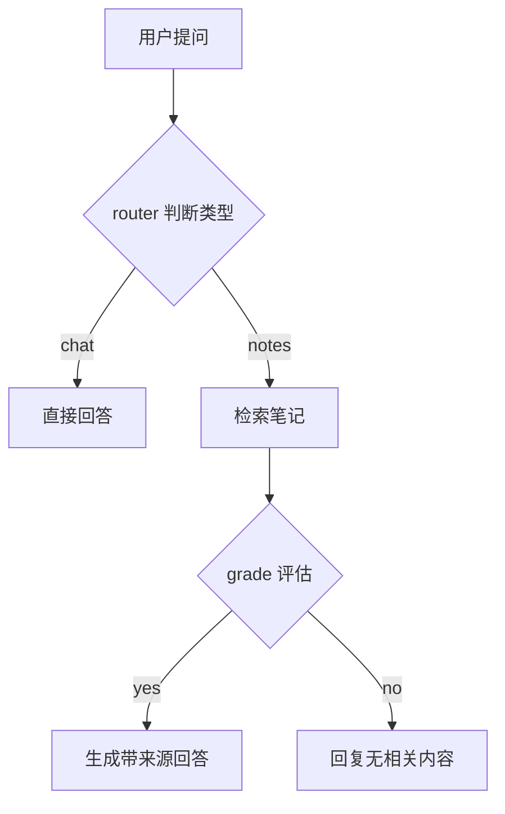

# LLM Compass · 学习笔记智能问答助手

> 基于 RAG 与 LangGraph 的个人学习笔记问答应用：把学习笔记变成可以提问、可以溯源、会承认"不知道"的知识库。

## 项目简介

LLM Compass 是一个基于个人学习笔记的检索增强生成（RAG）问答应用。它将 `notes/` 目录下的 Markdown 笔记向量化存入 Chroma 知识库；用户提问时，系统先判断问题类型，再检索相关笔记片段，由大模型生成带来源引用的回答。

项目同时提供命令行和网页两种使用方式，适合管理个人学习资料，也可以作为 RAG 与 LangGraph 应用开发的实践示例。

## 功能特性

- **多笔记加载**：自动加载 `notes/` 目录下的所有 Markdown 文档，支持随时新增、修改和删除。
- **内容指纹与索引重建**：启动时计算笔记内容指纹，并与上次索引记录比对；发现变化时自动重建向量库，无需手动维护。
- **RAG 智能问答**：先检索与问题相关的笔记片段，再由大模型基于检索内容生成回答，而不是只依赖模型自身知识。
- **检索质量评估**：由大模型判断检索内容是否足以回答问题；不足时明确回复"笔记中没有相关内容"，避免编造。
- **来源引用**：回答末尾列出实际使用的笔记文件名，方便回溯原文。
- **意图路由**：先判断问题是否属于学习类问题；问候和闲聊直接回应，不触发知识库检索。
- **FastAPI 接口**：提供 `POST /ask` 问答接口，供网页前端或其他客户端调用。
- **网页聊天界面**：提供简易聊天页面，区分用户与助手的消息，并展示当前会话的对话记录。

## 技术栈

- 语言与运行时：Python 3.12
- 编排框架：LangChain、LangGraph
- 向量数据库：Chroma
- 模型服务：OpenAI 兼容接口（聊天模型、嵌入模型）
- Web 服务：FastAPI + Uvicorn
- 前端：原生 HTML / CSS / JavaScript
- 配置管理：python-dotenv
- 版本管理：Git

## 系统架构



### 请求流程

1. 用户提问先进入 router，判断是学习类问题还是闲聊；
2. 闲聊走 `direct_answer`，直接由模型回应；
3. 学习类问题进入 `retrieve`，从笔记中检索相关片段；
4. `grade` 判断检索内容是否足以回答问题；
5. 内容足够时生成带来源的回答，否则明确回复笔记中没有相关内容。

## 项目结构

```text
.
├── app.py                 # 核心逻辑：加载、切分、索引、LangGraph 流程
├── api.py                 # FastAPI 服务：/ask、/health、网页入口
├── static/
│   └── index.html         # 网页聊天界面
├── notes/                 # 知识库源文件（Markdown）
├── chroma_db/             # 本地向量库（运行时生成，不提交）
├── requirements.txt       # 项目依赖
├── .env.example           # 环境变量模板
└── 复盘复盘.md            # 开发过程记录与问题复盘
```

## 运行方式

### 1. 环境要求

- Python 3.12+
- 可访问的 OpenAI 兼容模型服务（聊天模型 + 嵌入模型）

### 2. 安装依赖

```bash
python -m venv .venv
.venv\Scripts\activate
pip install -r requirements.txt
```

### 3. 配置环境变量

复制模板文件：

```bash
Copy-Item .env.example .env
```

然后在 `.env` 中填写以下配置：

| 变量名 | 说明 |
| --- | --- |
| `DASHSCOPE_API_KEY` | 模型服务的 API Key |
| `DASHSCOPE_BASE_URL` | OpenAI 兼容接口地址 |
| `CHAT_MODEL` | 聊天模型名称，例如 `qwen-max` |
| `EMBEDDING_MODEL` | 嵌入模型名称 |

### 4. 准备笔记

将 Markdown 笔记放入 `notes/` 目录。

- 首次启动时会自动构建向量库，因此第一次运行会慢一些；
- 笔记内容发生变化后，下次启动会自动检测并重建；
- 笔记目录为空时，检索结果为空，程序会提示笔记中没有相关内容。

### 5. 启动方式

命令行对话：

```bash
python app.py
```

启动 API 服务和网页界面：

```bash
uvicorn api:app --reload --port 8000
```

启动后访问：

- 网页聊天界面：<http://127.0.0.1:8000/>
- 接口文档：<http://127.0.0.1:8000/docs>
- 健康检查：<http://127.0.0.1:8000/health>

### 6. 接口说明

`POST /ask`

请求体：

```json
{
  "question": "什么是 reducer"
}
```

响应体：

```json
{
  "answer": "..."
}
```

## 关键设计

### 1. 内容指纹与索引重建

向量库不会知道源笔记已经发生变化。如果只判断"向量库是否为空"，新增笔记后旧索引会被继续使用，新内容无法被检索到。

项目在启动时对 `notes/` 下所有笔记的文件名与内容计算 SHA-256 指纹，并与向量库中记录的指纹比对；不一致时删除旧集合并重新构建索引。指纹只在所有批次成功入库后写入，避免把中断的残缺索引误认为完整索引。

局限：当前指纹只覆盖笔记内容，不包含嵌入模型等配置变化；更换模型后需要手动重建。

### 2. 两层判断：意图路由与检索质量评估

系统不直接对每个问题做检索，而是先用 router 判断问题类型：

- 问候、闲聊等非学习问题走 `direct_answer`，不触发知识库检索；
- 学习类问题进入检索流程。

检索完成后，`grade` 节点把"问题 + 检索内容"一起交给模型，判断内容是否足以回答问题。只有判断为足够时才生成答案，否则返回"笔记中没有相关内容"。

代价：一次学习类问答最多需要三次模型调用（路由、评估、生成），换取的是更可靠的判断和更清晰的责任划分。后续可以考虑用更小的模型承担分类任务来降低成本和延迟。

### 3. 来源引用与防幻觉

相似度检索总会返回最相近的 top-k 片段，即使这些片段与问题无关。因此，"检索不到内容"不能作为"无法回答"的唯一判断依据。

项目做了两层防护：

1. `grade` 节点判断检索内容是否足以回答问题；
2. 提示词要求模型在内容不足时直接说明"笔记中没有相关内容"，并禁止输出参考来源。

回答生成时会保留每个片段的来源文件名，并在回答末尾列出实际使用的来源，便于用户回溯原文。

### 4. FastAPI 与前后端分离

核心逻辑集中在 `app.py`，`api.py` 只负责把能力暴露成 HTTP 接口，网页通过 `POST /ask` 调用服务。命令行与网页两种入口共用同一套索引和 LangGraph 流程，避免逻辑重复。

## 已知限制与后续计划

当前限制：

- 笔记目前只支持 Markdown 格式；
- 对话没有跨会话的持久记忆；
- 检索尚未引入重排序、混合检索等优化；
- 指纹未纳入嵌入模型等配置变化；
- 尚未接入自动化评测集。

后续计划：

- 引入重排序或混合检索，并对比优化前后的效果；
- 建立测试问题集，评估检索命中率与回答质量；
- 支持更多文档格式；
- 增加会话历史与持久化；
- 部署为可公开访问的演示服务。

## 版本历史

| 版本 | 内容 |
| --- | --- |
| v0.1 | 单篇笔记 RAG 问答，修复入库与空库幻觉问题 |
| v0.2 | 多笔记加载、内容指纹与自动重建 |
| v0.3 | 回答带来源引用 |
| v0.4 | 迁移官方独立包，修复嵌入接口兼容问题 |
| v0.5 | 改造为 LangGraph 状态图 |
| v0.6 | 意图路由与检索质量评估 |
| v0.7 | FastAPI 服务化 |
| v0.8 | 网页聊天界面 |
| v0.9 | 配置外置与环境变量管理 |
